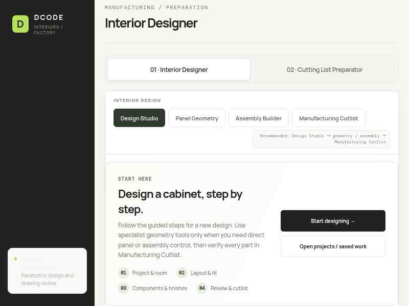
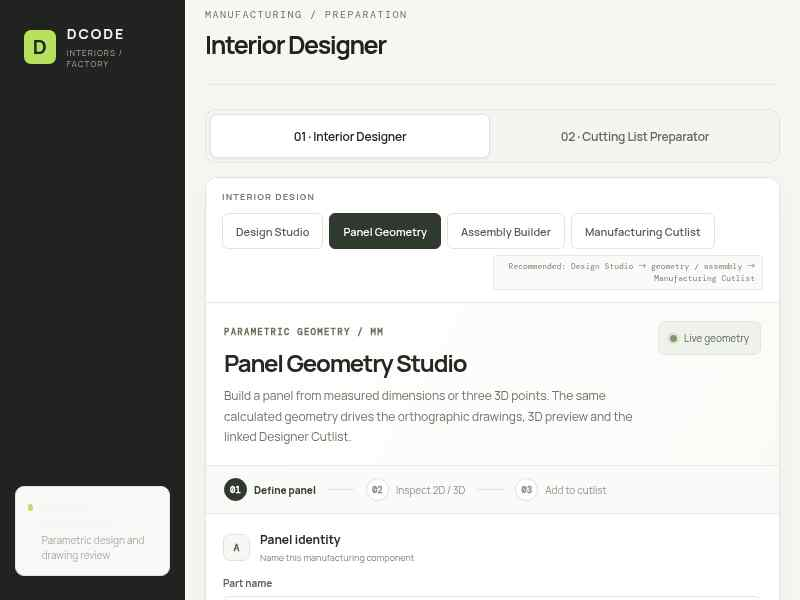
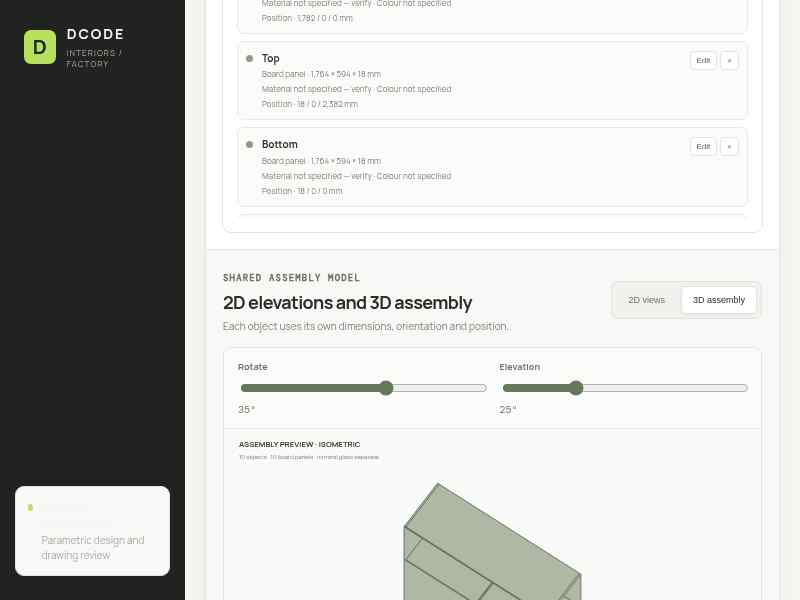
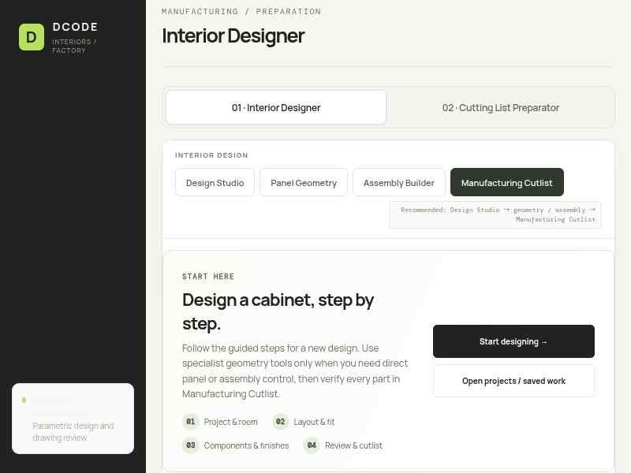

# DCODE Cutting List Preparator

Browser-based tool for extracting candidate panel dimensions from drawings and preparing interior-design cut lists.

## User manual

**[Open the complete User Field Guide](docs/USER_GUIDE.md)** — start-to-finish workflow, workspace instructions, 2D/3D parity checks, drawing extraction, materials and hardware, local saving and backups, troubleshooting, and the release checklist.

The same guide is intended to be available inside the app under **User Guide**. Actual application screenshots are referenced in the manual.

## Important

- Imported dimensions are candidates until checked against the original drawing.
- A rendered 2D/3D preview or a zero-intersection result is not manufacturing certification.
- Verify exact material, decor, grain, edge treatment, hardware model, clearances and machining details.
- Obtain responsible human approval before factory/CNC release.

## Actual application screenshots

These screenshots are captured from the application interface. The full walkthrough and instructions are in the [User Field Guide](docs/USER_GUIDE.md).

### Design Studio

### Panel Geometry

### Assembly Builder — 3D

### Manufacturing Cutlist

